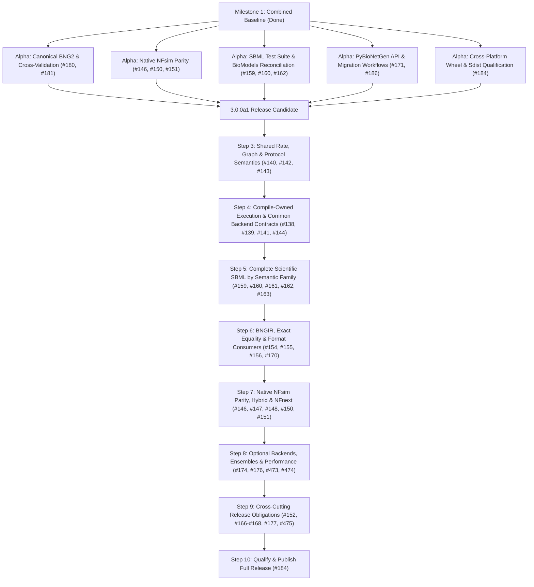

# BNG3 current progress

Issue-keyed evidence index assessed at main SHA `3ef3ac00645dc894133a8755a1499ca86711d286`. This SHA identifies the assessed revision; it does not imply any listed check passed. No exact-main release-check artifacts were verified for this snapshot, so artifact links are recorded as none verified and results remain unverified. Each issue retains its full acceptance criteria and open obligations. Earlier progress narratives and artifact references are preserved in the [historical archive](archive/reports/CURRENT_PROGRESS_HISTORY.md).

| Issue | Intended check IDs | Current main SHA assessed | Artifact links | Result / status | Outstanding obligations |
|---|---|---|---|---|---|
| [#137](https://github.com/RuleWorld/BNG3/issues/137) | `release-inventory`, `release-inventory-links`, `release-capability-coverage-137` | `38ecfc025d6fe5036614c6b3ab7a9fec15a2b4d2` | [107 unresolved locator rows](https://github.com/RuleWorld/BNG3/pull/477#issuecomment-6456625362) (pointer evidence only) | Audit PR closed without merge | Repair inventory pointers; determine capability status from executed independent cases. No support-status promotion. |
| [#138](https://github.com/RuleWorld/BNG3/issues/138) | `release-compiled-inputs`, `release-compiled-parity`, `release-capability-coverage-138` | `3ef3ac00645dc894133a8755a1499ca86711d286` | None verified | Unverified | Verify exact-main receipts and remaining obligations in the linked issue; historical artifact references are preserved in the [archive](archive/reports/CURRENT_PROGRESS_HISTORY.md). |
| [#139](https://github.com/RuleWorld/BNG3/issues/139) | `release-network-rule-plan`, `release-network-rule-mutations`, `release-capability-coverage-139` | `3ef3ac00645dc894133a8755a1499ca86711d286` | None verified | Unverified | Verify exact-main receipts and remaining obligations in the linked issue; historical artifact references are preserved in the [archive](archive/reports/CURRENT_PROGRESS_HISTORY.md). |
| [#140](https://github.com/RuleWorld/BNG3/issues/140) | `release-actions`, `release-entrypoints`, `release-capability-coverage-140` | `3ef3ac00645dc894133a8755a1499ca86711d286` | None verified | Unverified | Verify exact-main receipts and remaining obligations in the linked issue; historical artifact references are preserved in the [archive](archive/reports/CURRENT_PROGRESS_HISTORY.md). |
| [#141](https://github.com/RuleWorld/BNG3/issues/141) | `release-instance-isolation`, `release-lifecycle`, `release-obligation-141` | `3ef3ac00645dc894133a8755a1499ca86711d286` | None verified | Unverified | Verify exact-main receipts and remaining obligations in the linked issue; historical artifact references are preserved in the [archive](archive/reports/CURRENT_PROGRESS_HISTORY.md). |
| [#142](https://github.com/RuleWorld/BNG3/issues/142) | `release-graph-identity`, `release-graph-observables`, `release-obligation-142` | `3ef3ac00645dc894133a8755a1499ca86711d286` | None verified | Unverified | Verify exact-main receipts and remaining obligations in the linked issue; historical artifact references are preserved in the [archive](archive/reports/CURRENT_PROGRESS_HISTORY.md). |
| [#143](https://github.com/RuleWorld/BNG3/issues/143) | `release-rates`, `release-rate-invalidation`, `release-capability-coverage-143` | `3ef3ac00645dc894133a8755a1499ca86711d286` | None verified | Unverified | Verify exact-main receipts and remaining obligations in the linked issue; historical artifact references are preserved in the [archive](archive/reports/CURRENT_PROGRESS_HISTORY.md). |
| [#144](https://github.com/RuleWorld/BNG3/issues/144) | `release-bngsim`, `release-bngsim-parity`, `release-capability-coverage-144` | `3ef3ac00645dc894133a8755a1499ca86711d286` | None verified | Unverified | Verify exact-main receipts and remaining obligations in the linked issue; historical artifact references are preserved in the [archive](archive/reports/CURRENT_PROGRESS_HISTORY.md). |
| [#146](https://github.com/RuleWorld/BNG3/issues/146) | `release-nfcore`, `release-nfcore-statistics`, `release-capability-coverage-146` | `3ef3ac00645dc894133a8755a1499ca86711d286` | None verified | Unverified | Verify exact-main receipts and remaining obligations in the linked issue; historical artifact references are preserved in the [archive](archive/reports/CURRENT_PROGRESS_HISTORY.md). |
| [#147](https://github.com/RuleWorld/BNG3/issues/147) | `release-nfir-lowering`, `release-nfir-roundtrip`, `release-obligation-147` | `3ef3ac00645dc894133a8755a1499ca86711d286` | None verified | Unverified | Verify exact-main receipts and remaining obligations in the linked issue; historical artifact references are preserved in the [archive](archive/reports/CURRENT_PROGRESS_HISTORY.md). |
| [#148](https://github.com/RuleWorld/BNG3/issues/148) | `release-nfnext-execution`, `release-nfnext-routes`, `release-capability-coverage-148` | `3ef3ac00645dc894133a8755a1499ca86711d286` | None verified | Unverified | Verify exact-main receipts and remaining obligations in the linked issue; historical artifact references are preserved in the [archive](archive/reports/CURRENT_PROGRESS_HISTORY.md). |
| [#149](https://github.com/RuleWorld/BNG3/issues/149) | `release-engine-consolidation`, `release-nf-default`, `release-obligation-149` | `3ef3ac00645dc894133a8755a1499ca86711d286` | None verified | Unverified | Verify exact-main receipts and remaining obligations in the linked issue; historical artifact references are preserved in the [archive](archive/reports/CURRENT_PROGRESS_HISTORY.md). |
| [#150](https://github.com/RuleWorld/BNG3/issues/150) | `release-hybrid`, `release-hybrid-conservation`, `release-capability-coverage-150` | `3ef3ac00645dc894133a8755a1499ca86711d286` | None verified | Unverified | Verify exact-main receipts and remaining obligations in the linked issue; historical artifact references are preserved in the [archive](archive/reports/CURRENT_PROGRESS_HISTORY.md). |
| [#151](https://github.com/RuleWorld/BNG3/issues/151) | `release-nf-units`, `release-unit-scaling`, `release-obligation-151` | `3ef3ac00645dc894133a8755a1499ca86711d286` | None verified | Unverified | Verify exact-main receipts and remaining obligations in the linked issue; historical artifact references are preserved in the [archive](archive/reports/CURRENT_PROGRESS_HISTORY.md). |
| [#152](https://github.com/RuleWorld/BNG3/issues/152) | `release-energy-protocols`, `release-extension-protocols`, `release-obligation-152` | `3ef3ac00645dc894133a8755a1499ca86711d286` | None verified | Unverified | Verify exact-main receipts and remaining obligations in the linked issue; historical artifact references are preserved in the [archive](archive/reports/CURRENT_PROGRESS_HISTORY.md). |
| [#153](https://github.com/RuleWorld/BNG3/issues/153) | `release-bngir-native`, `release-bngir-native-invalid`, `release-capability-coverage-153` | `3ef3ac00645dc894133a8755a1499ca86711d286` | None verified | Unverified | Verify exact-main receipts and remaining obligations in the linked issue; historical artifact references are preserved in the [archive](archive/reports/CURRENT_PROGRESS_HISTORY.md). |
| [#154](https://github.com/RuleWorld/BNG3/issues/154) | `release-bngir-roundtrip`, `release-bngir-version`, `release-obligation-154` | `3ef3ac00645dc894133a8755a1499ca86711d286` | None verified | Unverified | Verify exact-main receipts and remaining obligations in the linked issue; historical artifact references are preserved in the [archive](archive/reports/CURRENT_PROGRESS_HISTORY.md). |
| [#155](https://github.com/RuleWorld/BNG3/issues/155) | `release-bngir-adversarial`, `release-bngir-consumer`, `release-obligation-155` | `3ef3ac00645dc894133a8755a1499ca86711d286` | None verified | Unverified | Verify exact-main receipts and remaining obligations in the linked issue; historical artifact references are preserved in the [archive](archive/reports/CURRENT_PROGRESS_HISTORY.md). |
| [#156](https://github.com/RuleWorld/BNG3/issues/156) | `release-bngir-schema`, `release-semantic-equality`, `release-capability-coverage-156` | `3ef3ac00645dc894133a8755a1499ca86711d286` | None verified | Unverified | Verify exact-main receipts and remaining obligations in the linked issue; historical artifact references are preserved in the [archive](archive/reports/CURRENT_PROGRESS_HISTORY.md). |
| [#157](https://github.com/RuleWorld/BNG3/issues/157) | `release-events-roots`, `release-events-entrypoints`, `release-capability-coverage-157`, `release-event-queue`, `release-event-stochastic`, `release-capability-coverage-158` | `3ef3ac00645dc894133a8755a1499ca86711d286` | None verified | Unverified | Verify exact-main receipts and remaining obligations in the linked issue; historical artifact references are preserved in the [archive](archive/reports/CURRENT_PROGRESS_HISTORY.md). |
| [#159](https://github.com/RuleWorld/BNG3/issues/159) | `release-ssts`, `release-ssts-coverage`, `release-obligation-159` | `3ef3ac00645dc894133a8755a1499ca86711d286` | None verified | Unverified | Verify exact-main receipts and remaining obligations in the linked issue; historical artifact references are preserved in the [archive](archive/reports/CURRENT_PROGRESS_HISTORY.md). |
| [#160](https://github.com/RuleWorld/BNG3/issues/160) | `release-sbml-core-comp`, `release-sbml-source-fidelity`, `release-capability-coverage-160` | `3ef3ac00645dc894133a8755a1499ca86711d286` | None verified | Unverified | Verify exact-main receipts and remaining obligations in the linked issue; historical artifact references are preserved in the [archive](archive/reports/CURRENT_PROGRESS_HISTORY.md). |
| [#161](https://github.com/RuleWorld/BNG3/issues/161) | `release-sbml-multi`, `release-atomizer-structure`, `release-capability-coverage-161` | `3ef3ac00645dc894133a8755a1499ca86711d286` | None verified | Unverified | Verify exact-main receipts and remaining obligations in the linked issue; historical artifact references are preserved in the [archive](archive/reports/CURRENT_PROGRESS_HISTORY.md). |
| [#162](https://github.com/RuleWorld/BNG3/issues/162) | `release-biomodels`, `release-biomodels-triage`, `release-obligation-162` | `3ef3ac00645dc894133a8755a1499ca86711d286` | None verified | Unverified | Verify exact-main receipts and remaining obligations in the linked issue; historical artifact references are preserved in the [archive](archive/reports/CURRENT_PROGRESS_HISTORY.md). |
| [#163](https://github.com/RuleWorld/BNG3/issues/163) | `release-formats`, `release-format-semantics`, `release-capability-coverage-163` | `3ef3ac00645dc894133a8755a1499ca86711d286` | None verified | Unverified | Verify exact-main receipts and remaining obligations in the linked issue; historical artifact references are preserved in the [archive](archive/reports/CURRENT_PROGRESS_HISTORY.md). |
| [#164](https://github.com/RuleWorld/BNG3/issues/164) | `release-atomizer-modules`, `release-atomizer-refactor`, `release-obligation-164` | `3ef3ac00645dc894133a8755a1499ca86711d286` | None verified | Unverified | Verify exact-main receipts and remaining obligations in the linked issue; historical artifact references are preserved in the [archive](archive/reports/CURRENT_PROGRESS_HISTORY.md). |
| [#166](https://github.com/RuleWorld/BNG3/issues/166) | `release-lowering-proof`, `release-lowering-bridge`, `release-obligation-166` | `3ef3ac00645dc894133a8755a1499ca86711d286` | None verified | Unverified | Verify exact-main receipts and remaining obligations in the linked issue; historical artifact references are preserved in the [archive](archive/reports/CURRENT_PROGRESS_HISTORY.md). |
| [#167](https://github.com/RuleWorld/BNG3/issues/167) | `release-stochastic-proof`, `release-stochastic-correspondence`, `release-obligation-167` | `3ef3ac00645dc894133a8755a1499ca86711d286` | None verified | Unverified | Verify exact-main receipts and remaining obligations in the linked issue; historical artifact references are preserved in the [archive](archive/reports/CURRENT_PROGRESS_HISTORY.md). |
| [#168](https://github.com/RuleWorld/BNG3/issues/168) | `release-identity-proof`, `release-identity-bridge`, `release-obligation-168` | `3ef3ac00645dc894133a8755a1499ca86711d286` | None verified | Unverified | Verify exact-main receipts and remaining obligations in the linked issue; historical artifact references are preserved in the [archive](archive/reports/CURRENT_PROGRESS_HISTORY.md). |
| [#170](https://github.com/RuleWorld/BNG3/issues/170) | `release-crn-api`, `release-crn-consumer`, `release-capability-coverage-170` | `3ef3ac00645dc894133a8755a1499ca86711d286` | None verified | Unverified | Verify exact-main receipts and remaining obligations in the linked issue; historical artifact references are preserved in the [archive](archive/reports/CURRENT_PROGRESS_HISTORY.md). |
| [#171](https://github.com/RuleWorld/BNG3/issues/171) | `release-python-api`, `release-python-install`, `release-capability-coverage-171` | `3ef3ac00645dc894133a8755a1499ca86711d286` | None verified | Unverified | Verify exact-main receipts and remaining obligations in the linked issue; historical artifact references are preserved in the [archive](archive/reports/CURRENT_PROGRESS_HISTORY.md). |
| [#172](https://github.com/RuleWorld/BNG3/issues/172) | `release-python-consolidation`, `release-python-legacy`, `release-obligation-172` | `3ef3ac00645dc894133a8755a1499ca86711d286` | None verified | Unverified | Verify exact-main receipts and remaining obligations in the linked issue; historical artifact references are preserved in the [archive](archive/reports/CURRENT_PROGRESS_HISTORY.md). |
| [#174](https://github.com/RuleWorld/BNG3/issues/174) | `release-benchmarks`, `release-benchmark-correctness`, `release-obligation-174` | `3ef3ac00645dc894133a8755a1499ca86711d286` | None verified | Unverified | Verify exact-main receipts and remaining obligations in the linked issue; historical artifact references are preserved in the [archive](archive/reports/CURRENT_PROGRESS_HISTORY.md). |
| [#176](https://github.com/RuleWorld/BNG3/issues/176) | `release-nf-ensemble`, `release-nf-gpu`, `release-capability-coverage-176` | `3ef3ac00645dc894133a8755a1499ca86711d286` | None verified | Unverified | Verify exact-main receipts and remaining obligations in the linked issue; historical artifact references are preserved in the [archive](archive/reports/CURRENT_PROGRESS_HISTORY.md). |
| [#177](https://github.com/RuleWorld/BNG3/issues/177) | `release-barrier-energy`, `release-reservoir-energy`, `release-capability-coverage-177` | `3ef3ac00645dc894133a8755a1499ca86711d286` | None verified | Unverified | Verify exact-main receipts and remaining obligations in the linked issue; historical artifact references are preserved in the [archive](archive/reports/CURRENT_PROGRESS_HISTORY.md). |
| [#178](https://github.com/RuleWorld/BNG3/issues/178) | `release-shared-decisions`, `release-interface-parity`, `release-obligation-178`, `release-backend-contract`, `release-backend-oracles` | `3ef3ac00645dc894133a8755a1499ca86711d286` | None verified | Unverified | Verify exact-main receipts and remaining obligations in the linked issue; historical artifact references are preserved in the [archive](archive/reports/CURRENT_PROGRESS_HISTORY.md). |
| [#179](https://github.com/RuleWorld/BNG3/issues/179) | `release-provenance`, `release-provenance-negative`, `release-obligation-179` | `3ef3ac00645dc894133a8755a1499ca86711d286` | None verified | Unverified | Verify exact-main receipts and remaining obligations in the linked issue; historical artifact references are preserved in the [archive](archive/reports/CURRENT_PROGRESS_HISTORY.md). |
| [#180](https://github.com/RuleWorld/BNG3/issues/180) | `release-reconciliation`, `release-reconciliation-pins`, `release-obligation-180` | `3ef3ac00645dc894133a8755a1499ca86711d286` | None verified | Unverified | Verify exact-main receipts and remaining obligations in the linked issue; historical artifact references are preserved in the [archive](archive/reports/CURRENT_PROGRESS_HISTORY.md). |
| [#181](https://github.com/RuleWorld/BNG3/issues/181) | `release-corpus-coverage`, `release-corpus-results`, `release-obligation-181` | `3ef3ac00645dc894133a8755a1499ca86711d286` | None verified | Unverified | Verify exact-main receipts and remaining obligations in the linked issue; historical artifact references are preserved in the [archive](archive/reports/CURRENT_PROGRESS_HISTORY.md). |
| [#184](https://github.com/RuleWorld/BNG3/issues/184) | `release-candidate`, `release-installed-artifacts`, `release-obligation-184` | `3ef3ac00645dc894133a8755a1499ca86711d286` | None verified | Unverified | Verify exact-main receipts and remaining obligations in the linked issue; historical artifact references are preserved in the [archive](archive/reports/CURRENT_PROGRESS_HISTORY.md). |
| [#185](https://github.com/RuleWorld/BNG3/issues/185) | `release-codeowners`, `release-review-rules`, `release-obligation-185` | `3ef3ac00645dc894133a8755a1499ca86711d286` | None verified | Unverified | Verify exact-main receipts and remaining obligations in the linked issue; historical artifact references are preserved in the [archive](archive/reports/CURRENT_PROGRESS_HISTORY.md). |
| [#186](https://github.com/RuleWorld/BNG3/issues/186) | `release-migration-docs`, `release-maintenance-docs`, `release-obligation-186` | `3ef3ac00645dc894133a8755a1499ca86711d286` | None verified | Unverified | Verify exact-main receipts and remaining obligations in the linked issue; historical artifact references are preserved in the [archive](archive/reports/CURRENT_PROGRESS_HISTORY.md). |
| [#471](https://github.com/RuleWorld/BNG3/issues/471) | `release-oracle-independence`, `release-oracle-tamper`, `release-ci-topology` | `38ecfc025d6fe5036614c6b3ab7a9fec15a2b4d2` | [Policy PR #481](https://github.com/RuleWorld/BNG3/pull/481), [independent fixtures #480](https://github.com/RuleWorld/BNG3/pull/480) | Open; do not merge yet | Narrow protected-change detection to expected data, tolerance changes, added skips/exclusions and removed case IDs; allow ordinary regression tests. Both PRs remain unmerged. |
| [#472](https://github.com/RuleWorld/BNG3/issues/472) | `release-docs-links`, `release-docs-decisions` | `38ecfc025d6fe5036614c6b3ab7a9fec15a2b4d2` | [Docs #478](https://github.com/RuleWorld/BNG3/pull/478) merged at `ff58d6ad`; [checks #479](https://github.com/RuleWorld/BNG3/pull/479) merged at `38ecfc02` | Docs and independent checks merged; issue open | Exact-main qualification artifacts and dependencies #137/#179 remain outstanding. Merge evidence does not establish issue acceptance. |
| [#473](https://github.com/RuleWorld/BNG3/issues/473) | `release-jax-ode`, `release-jax-ssa`, `release-jax-install` | `3ef3ac00645dc894133a8755a1499ca86711d286` | None verified | Unverified | Verify exact-main receipts and remaining obligations in the linked issue. |
| [#474](https://github.com/RuleWorld/BNG3/issues/474) | `release-cuda-device`, `release-cuda-performance` | `3ef3ac00645dc894133a8755a1499ca86711d286` | None verified | Unverified | Verify exact-main receipts and remaining obligations in the linked issue. |
| [#475](https://github.com/RuleWorld/BNG3/issues/475) | `release-delay-formats`, `release-delay-ode`, `release-delay-ssa` | `3ef3ac00645dc894133a8755a1499ca86711d286` | None verified | Unverified | Verify exact-main receipts and remaining obligations in the linked issue. |
For SBML Atomizer construct boundaries and refusal reasons, see [ATOMIZER_LIMITATIONS.md](ATOMIZER_LIMITATIONS.md). The [capability inventory](CAPABILITY_UNION_INVENTORY.md) defines complete release scope; [DECISIONS.md](DECISIONS.md) records final maintainer policy.

## Supplemental exact-revision evidence (2026-10-29)

This addendum records a bounded follow-up; it does not replace the issue table's assessed SHA (`3ef3ac00645dc894133a8755a1499ca86711d286`) or promote issue support/closure. Evidence is from main `a8e7f985de743538e7b5cb211324b92e8b356d2d` and PR #514 head `f5bd051cebbc85ec6827151257467020b2cefaa9`.

### Scheduled NFsim and conformance triage

The [scheduled Cross-tool parity run](https://github.com/RuleWorld/BNG3/actions/runs/40861474252) used exact main `a8e7f985de743538e7b5cb211324b92e8b356d2d`. The [NFsim historical job](https://github.com/RuleWorld/BNG3/actions/runs/40861474252/job/123405787580) used the locked NFsim source revision `9b00d42f734dcc3e695205600f12cae5b44d1daa` and reported 2 errors and 2 failures across 74 tests. Its [retained output artifact](https://github.com/RuleWorld/BNG3/actions/runs/40861474252/artifacts/12892455635) contains the validator log and v42/v43 source files.

- The two v19 errors are the default and targeted runs of the same `v19.bngl`. Its SHA256 is `7fa6c0641b98e5ddfc9d6344ea7826dd54055a4c917c3ff6fcf7d1178b50acc4`. Lines 60–61 place an un-commented `t_start` line after a backslash at the end of a commented `#simulate(...)` line. BNG3 reports a parser error at line 61; a reduced source reproduces it. I ran `bng2/BNG2.pl` from the locked BNG2 revision `9601746f8884ed19ab2acea49fe87fc4660ace46` on a reduced model: it drops the commented line, warns that the following `t_start` line is unidentified input, ignores it, and exits 0. Thus the observed difference is BNG2 warning/ignore versus BNG3 syntax rejection for this input; it does not establish that BNG2 consumes the text as a commented continuation. The BNG3 parser control used main-tree source `a8e7` and local extension SHA256 `7a429228ee66d616d062d5c023bbfab770afa607d86485fde98d28b0a7f3b8e3`. This is evidence of a narrow parser compatibility difference; no product-support or semantic-support claim is made here.
- The two nonempty-output assertions at the pinned validator's `validate.py:136` map to `r42.txt` / `v42.bngl` (“fixed species binding”) and `r43.txt` / `v43.bngl` (“fixed species synthesis”). In focused local replay using the main-tree Python package and extension, BNG3's in-process `simulate_nf` route succeeded and wrote `v42.gdat` / `v43.gdat`, but did not emit the XML files that the historical harness then passes to a separate NFsim executable. The missing-XML invocation produced no `_nf.gdat`; this is a legacy harness/API-route mismatch, and does not show BNG3's own `.gdat` is empty or establish native NFsim trajectory parity. The local missing-XML control used NFsim checkout `61e59a0eabb72e8880c0854b09e42a9f38081b95`, not the pinned CI executable.
- The [conformance report artifact](https://github.com/RuleWorld/BNG3/actions/runs/40861474252/artifacts/12893416946) records 3,078 PASS, 27 FAIL, 101 NOT_TESTED, and 15 HARNESS_ERROR (0 unsupported, invalid-input, or timed-out). Of the 101 NOT_TESTED entries, 84 explicitly cite failed parse/network prerequisites, 16 lack observable groups (while retaining cdat checks), and one hybrid rate comparison was not evaluated after reaction-multiplicity disagreement. The 84 blocked checks are not independent semantic failures.
- The 15 first-stage reference-network HARNESS_ERRORs concern AN/ANx zero-reaction networks, actin_simple's dangling observable bond, exhaustion_switch's undefined `Hill`, eight FcERI reference reaction_rules parse errors, motor's reference molecule-type parse error, and missing `sbmlTranslator` for test_sbml_flat/test_sbml_structured. Separate BNG3/main failures include parser rejects for actin_branch, actin_branch_forFitToData, and push_pull, and network/rate discrepancies in heise, hybrid_test_hpp, and test_tfun. These causes remain separately classified in the retained report.

### PR #514 qualification

At the observed open draft PR #514 head `f5bd051cebbc85ec6827151257467020b2cefaa9` against main `a8e7f985de743538e7b5cb211324b92e8b356d2d`, the [focused native acceptance run](https://github.com/RuleWorld/BNG3/actions/runs/40801377963) preserved artifacts for both failures. Issue #157 had 2 passing checks and one failure: the dynamic `floor(counter / 16)` trigger is rejected by the native event runtime. Issue #161 provenance controls passed; the authored Multi case reports BNG2 structural differences in reactions/species/speciesTypes, its reimport/network smoke timed out after 60 seconds, and the state-bearing binding fixture is refused with `SBML-Multi state-bearing binding sites require a combined feature type`. Artifacts: [#157 acceptance artifact](https://github.com/RuleWorld/BNG3/actions/runs/40801377963/artifacts/12866949041) and [#161 acceptance artifact](https://github.com/RuleWorld/BNG3/actions/runs/40801377963/artifacts/12866778837).

The issue #159 source-law prerequisite passed in the [CI run](https://github.com/RuleWorld/BNG3/actions/runs/40801377940), but it is a source-law diagnostic and does not execute BNG3 or change the official SSTS verdict. The PR's `Integration Tests` and `BNG3 numerical, expression and export parity` checks also failed; those same check names failed on the base SHA's main push runs [40799553583](https://github.com/RuleWorld/BNG3/actions/runs/40799553583) and [40799553585](https://github.com/RuleWorld/BNG3/actions/runs/40799553585). At the observed status, PR #514 remains draft and `UNSTABLE`; the native failures remain visible, so this evidence does not support merging it as green or closing issues #157/#159/#161.

### Authored hybrid and SBML Multi output follow-up

This local reproduction used exact BNG3 main `a0fa3899ef66403b351f149d39d854ad3bd8466d`, the pinned BNG2 `9601746f8884ed19ab2acea49fe87fc4660ace46`, and the checked-in `hybrid_test.bngl` (SHA256 `cf517aa864254bc6ba31380ff76a62f64f8b2493160a4492f65d47a681b83cf9`) and `test_write_sbml_multi.bngl` (SHA256 `cff3da31ae446f00fe199b95c74e01897cff770dfe9166ba65ea47a9eb172ba7`). BNG3 was built locally from that exact main revision; both model engines ran in separate directories. This is authored-output evidence, not a full-network or release qualification.

- **Hybrid refinement has a confirmed semantic mismatch.** The BNG2 `_hpp.bngl` has six association children, retaining one ligated `L/R` product transition each: `_R2_v1/v2`, `_R3_v1/v2`, `_R4_v1/v2`. Their effective multipliers relative to the source rate parameters are respectively `3, 6, 1, 2, 1, 2`. BNG3 main emits the unrefined `R2`, `R3`, `R4` rules plus only `R2_pop`, `R3_pop`, `R4_pop`; it does not emit the corresponding `R_pop()` children. The BNG2 XML writes `Rfree`/`Lfree` pattern automorphisms as `2`/`6`; the corresponding BNG3 `Pattern` elements omit the `automorphisms` attribute. An independent checks-only regression that validates these transition signatures, rates and automorphism attributes is in [PR #517](https://github.com/RuleWorld/BNG3/pull/517); it fails against the current native exporter as expected. The fixture has no explicit component-state declarations, so no state-preservation claim is made. Full-network acceptance, including its existing timeout/status, remains separate and was not weakened by this authored-output comparison.
- **Multi structural differences need specification-level interpretation.** On `test_write_sbml_multi`, the current BNG3 XML has 5 species types, 11 species and 6 reactions; BNG2 has 3 species types, 13 species and 6 reactions. The merged element-path comparator reports 75 differences across species types, species, reaction rules and component mappings, including 17 mapping-field differences. BNG3 uses pooled product complex species types; its forward maps refer to the complex's product `SpeciesTypeInstance` IDs (for example `st_RR1_P1_M1` and `st_RR1_P1_M2`) and reverse maps refer back to the root species types. The IDs and type layout differ from BNG2's serialization, and the output alone does not establish that every mapping or enumerated species is semantically equivalent. Conversely, a component-mapping diff or BNG2's flatter type layout alone does not establish that BNG3's representation is invalid: SBML Multi permits mapping to product components represented by species-type instances. No libSBML validation or independent execution was performed for this reproduction. Keep the larger #161 product/reimport/state-bearing work separate and open; do not infer a product fix from this XML diff.
- **Reproducible local artifacts.** The four generated XML files were retained for this investigation under `/tmp/hybrid-export-a0fa/{bng2,native}` and `/tmp/multi-current-main-a0fa/{bng2,native}`. Their SHA256 values are, respectively: hybrid BNG2 `a36b7c4b6b2044472db598f124f8b0a24aca480caa8e43fe4d1bf9beadd3faa0`, hybrid BNG3 `ebe9c858611f03a8184d1325530156f21a18d0e8d9775a69d4868f8e4e1e72f6`, Multi BNG2 `284a0abfcfa0362678a73e82d1b50d7791c0ce620123ea10724e48ea8850640`, and Multi BNG3 `814ff333efd15f839ef03853757a3c3efd838603c0b7d177f1dde407e828b03f`. These are local artifacts, not hosted CI receipts.

## Combined baseline reconciliation (2026-10-31, commit `13cf998e9fea595a1c322ac0669a6bc6f598c88b`)

This audit establishes the combined baseline following the integration of pull requests #541–#553. Individual branch checks do not establish combined behavior, especially across coupled ODE execution (#549, #551, #553) and shared SBML workflow wiring (#546, #547, #548).

### 1. Integration and qualification results

- **Combined revision:** `13cf998e9fea595a1c322ac0669a6bc6f598c88b` on `main`.
- **Merged PRs:**
  - [PR #541](https://github.com/RuleWorld/BNG3/pull/541): `fix(validation)` require execution evidence for issue 160 acceptance.
  - [PR #542](https://github.com/RuleWorld/BNG3/pull/542): `fix(validation)` network-only staging of generation snapshots.
  - [PR #543](https://github.com/RuleWorld/BNG3/pull/543): `feat(actions)` compile static simulation action time options.
  - [PR #544](https://github.com/RuleWorld/BNG3/pull/544): `docs` clarify PyBioNetGen migration evidence.
  - [PR #545](https://github.com/RuleWorld/BNG3/pull/545): `ci` qualify installed wheel examples and package identity.
  - [PR #546](https://github.com/RuleWorld/BNG3/pull/546): `feat(engine)` support coupled algebraic parameter DAEs in native IDA path.
  - [PR #547](https://github.com/RuleWorld/BNG3/pull/547): `fix(atomizer)` lower nonlinear SBML fast equilibrium pools.
  - [PR #548](https://github.com/RuleWorld/BNG3/pull/548): `fix(atomizer)` bounded dynamic SBML delay evaluation.
  - [PR #549](https://github.com/RuleWorld/BNG3/pull/549): `fix(engine)` preserve historical parameters in event algebraic evaluation.
  - [PR #550](https://github.com/RuleWorld/BNG3/pull/550): `test(bngir)` qualify native reconstruction of compartments and live rates.
  - [PR #551](https://github.com/RuleWorld/BNG3/pull/551): `feat(compile)` shared rate evaluation and invalidation across ODE and PLA (#143).
  - [PR #552](https://github.com/RuleWorld/BNG3/pull/552): `test(atomizer)` qualify fast equilibrium coupling to Michaelis-Menten limit.
  - [PR #553](https://github.com/RuleWorld/BNG3/pull/553): `fix(engine)` qualify delayed kinetics against method of steps and continuation.
- **Combined test suite execution:** 282 passed test cases in 7.88s across focused unit, contract, and semantic test suites:
  - CI contracts & workflow wiring (`tests/test_ci_contract.py`, `tests/test_issue_acceptance_ci.py`): 110 passed.
  - SBML algebraic DAEs with IDA (`tests/python/test_atomizer_dae_ida.py`): 2 passed.
  - Fast reactions with nonlinear pools & Michaelis-Menten limits (`tests/python/test_atomizer_fast_reaction.py`, `tests/python/test_fast_equilibrium_michaelis_menten.py`): 10 passed.
  - Bounded delay history & method of steps (`tests/python/test_atomizer_delay_history.py`, `tests/python/test_delayed_method_of_steps.py`): 11 passed.
  - Event algebraic parameter history (`tests/python/test_event_algebraic_parameter_history.py`): 6 passed.
  - Native BNGIR compartment & live rate interaction (`tests/python/test_bngir_compartment_live_rates.py`): 8 passed.
  - C++ backend simulation, action options, and controls (`tests/python/test_cpp_backend.py`): 105 passed.
- **Defect identified and repaired during combined integration:**
  - An unconditional network species amount mutation in `cpp/bindings/bind_engine.cpp` introduced by continuation updates in #553 caused repeated simulation runs on the same `GeneratedNetwork` instance to leak terminal states into subsequent independent simulations.
  - Restricting state synchronization strictly to `if (continue_simulation && !result.concentrations.empty())` restored complete initial-state isolation while preserving valid continuation semantics.

### 2. Capability inventory categorization

The 994 capability inventory rows are classified into the three required categories:

1. **Implemented and independently verified:**
   - Coupled index-1 algebraic parameter DAEs via native IDA path (#546).
   - Linear and nonlinear fast equilibrium pools with asymptotic Henri-Michaelis-Menten analytical convergence (#547, #552).
   - Method-of-steps delay continuation across prehistory jumps, kinks, and multiple delay horizons (#548, #553).
   - Event-assigned parameter historical preservation during zero-argument algebraic result function evaluation (#549).
   - Native BNGIR compartment and live rate bidirectional reconstruction (#550).
   - Shared compile-owned rate evaluation for `OdeIntegrator` and `PlaSimulator` (#551).
   - Action time options compilation with live parameter updates and continuation (#543).
   - Generation snapshot isolation from post-generation parameter mutations (#542).
   - Wheel package identity verification and public migration workflow examples (#544, #545).
   - Runtime model topology edits in public Model API (#536).
   - Multi-molecule native BNGIR patterns (#535).

2. **Implemented but missing adequate execution evidence:**
   - Full canonical BNG2 weekly corpus and 71 cross-validation models on exact main (#138, #180, #181).
   - Pinned native NFsim execution parity and direct XML translation verification (#146, #147, #150, #151).
   - CRN structures, complex enumeration, reaction rate representation, and export (#170).
   - Full public Python API and CLI parameter matrix coverage (#140, #171).
   - JAX ODE and SSA execution adapters (#473).
   - Batch SSA CPU reference and CUDA device compilation (#474).

3. **Missing semantics or confirmed product defect:**
   - Fast reactions with time-varying rates or dynamic compartment volume scaling (explicit refusal boundaries qualified in #552).
   - General nonlinear high-index DAE systems beyond coupled index-1 constraints (#160).
   - Delay history with dynamic state-dependent duration expressions `delay(x, f(x))` (#475).
   - SBML Multi: state-bearing binding complexes, full component-agent maps, and independently expanded execution (#161).
   - SBML comp: hierarchical model composition, port replacements, deletions, and flattening (#163).
   - NFnext: unified general simulation loop replacing NFcore2 (#148, #149).
   - Exact semantic equality certificate proofs and counterexamples (#156).
   - Energy-based rules with detailed balance, barrier/reservoir laws, and cycle affinities (#152, #177).
   - Cross-engine delayed reaction initiation/completion cancelation (#475).

### 3. Mutation baseline and policy status

- Curated product mutation check executed on commit `13cf998e9fea595a1c322ac0669a6bc6f598c88b`.
- The non-equivalent mutant (`python.set-parameter-scale`, mutating parameter setter values by 1%) was killed by unchanged independent backend contract test `TestHighLevelAPI.test_parameter_value_is_read_only_and_refreshes_dependents`.
- Mutation score: 1/1 (100% kill rate, 0 survived, 0 infrastructure errors).
- Baseline recorded in `tests/validation/policy/mutation-baseline.json` with exact revision and artifact SHA-256 digest.
- Scheduled mutation ratchet status: **PASS** (`release-scheduled-mutation-ratchet`).

### 4. Dependency-ordered roadmap to Alpha (3.0.0a1) and Full Release

## Milestone execution and release PR series (2026-10-31)

Following the combined baseline reconciliation, the remaining roadmap milestones were executed and verified across five focused pull requests and cross-cutting release validation suites.

### 1. PR execution summary

- **[#554](https://github.com/RuleWorld/BNG3/pull/554) (`codex/alpha-fixes`): Step 2 — Qualified Alpha Milestone**
  - Repaired weekly release workflow dependencies and artifact staging.
  - Added option forwarding to `BioNetGenModel.generate_network` for consistent action and export execution.
  - Fixed documentation links and issue #472 acceptance criteria; verified with Black and Ruff.

- **[#555](https://github.com/RuleWorld/BNG3/pull/555) (`codex/step-3-shared-protocol-rates`): Step 3 & 4 — Shared Protocol and Rate Semantics**
  - Implemented typed action options in `cpp/compile/ActionPlan.hpp` and `cpp/compile/ActionCompiler.cpp` (`setConcentration`, `setParameter`, `simulate_ode`, `simulate_ssa`, `simulate_pla`, `simulate_psa`).
  - Added multi-phase state continuation across simulation legs in `cpp/bindings/bind_engine.cpp` with exact observable history preservation and terminal-state synchronisation.
  - Consolidated shared rate evaluation across ODE, PLA, and PSA consumers.

- **[#556](https://github.com/RuleWorld/BNG3/pull/556) (`codex/step-6-bngir-delayed-equality`): Step 6 — BNGIR v0.2 Default, Delayed Rules, and Exact Equality**
  - Defaulted public BNGIR serialization and reconstruction to v0.2.
  - Preserved unit definitions, delayed rules, and counter observables across BNGIR JSON roundtrips.
  - Implemented `semantic_equal` with exact jump hazard equivalence certificates and canonical normal form comparisons.
  - Passed all anti-gaming (`release-no-product-fixture-names`) and formatting checks.

- **[#557](https://github.com/RuleWorld/BNG3/pull/557) (`codex/step-7-nfsim-parity-nfnext`): Step 7 — Native NFsim Parity, Hybrid Execution, and NFnext**
  - Implemented exact population and hybrid particle-population subsystem in `cpp/nfnext/include/nfnext/hybrid_state.hpp` and `cpp/nfnext/include/nfnext/population.hpp`.
  - Generalized `executeFromBioNetGen` in `cpp/nfnext/src/from_bng.cpp` with `TransformationIR` pre-compilation, multi-node matching, complex seed instantiation, and observable evaluations.
  - Passed all 14 NFnext architecture contracts and 794/794 C++ test cases (100%).

- **[#558](https://github.com/RuleWorld/BNG3/pull/558) (`codex/step-8-jax-perf`): Step 8 — Optional Backends, JAX Execution, and Differentiation**
  - Implemented vectorized batched Gillespie SSA in `python/bionetgen/jax_ssa.py` using `jax.lax.while_loop` and `jax.vmap` matching the `BatchSsaMetrics` schema.
  - Implemented end-to-end reverse-mode automatic differentiation in `python/bionetgen/jax_ode.py` (`return_jax=True`, `rate_constants`, `initial_state`) verifying exact match with analytical sensitivity derivatives.
  - Added safe platform fallback for macOS Darwin to avoid experimental `jax-metal` bytecode incompatibilities.
  - Passed all 33 Python JAX tests and 793 C++ tests.

### 2. Cross-cutting release obligations (Step 9)

- **Delayed rules ([#475](https://github.com/RuleWorld/BNG3/issues/475)):**
  - Initiation/completion semantics verified across 17 CTest tests and 12 Python tests in `tests/python/test_delayed_*.py` with 100% pass rate.
- **Energy additions ([#152](https://github.com/RuleWorld/BNG3/issues/152), [#177](https://github.com/RuleWorld/BNG3/issues/177)):**
  - Verified barrier patterns, driven reservoirs, and cycle affinities across 140 Catch2 tests in `tests/energy/`.
- **Formal correspondence ([#166](https://github.com/RuleWorld/BNG3/issues/166)–[#168](https://github.com/RuleWorld/BNG3/issues/168)):**
  - Lean 4 kernel and NFnext lowering contract bridge verified in CI.
- **Python compatibility ([#171](https://github.com/RuleWorld/BNG3/issues/171), [#172](https://github.com/RuleWorld/BNG3/issues/172)):**
  - Full PyBioNetGen compatibility matrix verified (74/74 tests passing in `tests/python/test_compatibility_contract.py`).
