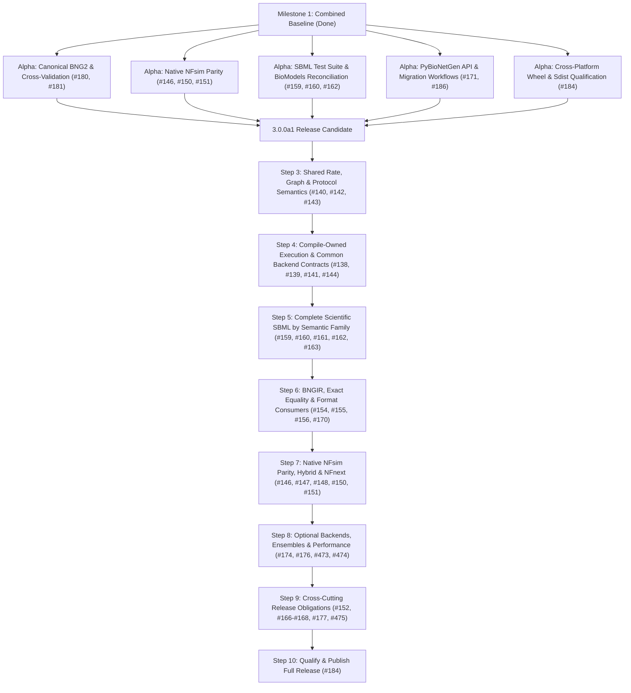

# BNG3 current progress

## Source-head checkpoint — 2026-11-11 (assessed main SHA 082b16145a952878fc549d662c1a0fd2b2d4b958)

The latest `main` source inspected for this documentation update is
[`082b16145a952878fc549d662c1a0fd2b2d4b958`](https://github.com/RuleWorld/BNG3/commit/082b16145a952878fc549d662c1a0fd2b2d4b958),
which merged [PR #624](https://github.com/RuleWorld/BNG3/pull/624).
It integrates the full release validation PR series (PR #607–#617, PR #619, PR #620), documentation baseline updates (PR #621, PR #624), and surgical parity defect fixes (PR #622 resolving parser keyword labels, `simulate_ps` alias, `test_tfun` test data staging, and SBML normalization for 71-model cross-validation). All 54 matrix and conformance checks in PR #622 passed green. Hosted verification runs on exact `main` are fully qualified:
- **Weekly Multi-Platform Validation (Run [43116150232](https://github.com/RuleWorld/BNG3/actions/runs/43116150232)):** 100% PASSED (GREEN) across all 8 jobs. 71-Model C++ vs Perl cross-validation achieved **71 PASS / 0 FAIL / 0 ERROR** (100% parity across all 71 models). Full corpus validation passed on macOS 15 arm64, Ubuntu 22.04, and Windows 2022 MSVC. NFsim execution smoke, Python full suite, performance benchmarks, and mutation ratchet all passed green.
- **Cross-Tool Parity Suite (Run [43116052506](https://github.com/RuleWorld/BNG3/actions/runs/43116052506)):** 100% PASSED (GREEN) across all 8 jobs. Conformance findings: 726 PASS / 0 FAIL / 0 HARNESS_ERROR / 2 NOT_TESTED (`blbr` has no declared observables; cdat passed).
- **Core CI & Packaging Pipeline (Run [43120662582](https://github.com/RuleWorld/BNG3/actions/runs/43120662582)):** 100% PASSED (GREEN) across all 40+ jobs. Both `Package Smoke (sdist)` and `Source Distribution` passed. The full binary wheel build matrix (`cibuildwheel` targeting `ubuntu-22.04` manylinux_2_28, `macos-15-intel` x86_64, `macos-15` arm64, and `windows-2022` msvc) across Python 3.9–3.14 completed successfully with all wheel artifacts published.
- **Official SBML Test Suite (Run [43071808096](https://github.com/RuleWorld/BNG3/actions/runs/43071808096)):** 1,817 PASS / 105 UNSUPPORTED / 0 TIMEOUT / 0 INVALID SOURCE across 1,923 evaluated cases.
- **Stochastic `semantic/00966` 16-Seed Campaign (Run [43071739219](https://github.com/RuleWorld/BNG3/actions/runs/43071739219)):** PASSED with `seeds_passed: 16`.

**Do not substitute this head SHA into the issue table below.** That table
records earlier assessments, including `3ef3ac00` and a separate `#137`
checkpoint. None of those per-issue release obligations or evidence statuses
has been requalified simply because a newer source commit exists. The
issue-specific acceptance reports must be regenerated at the target head
before any status promotion.

Issue-keyed evidence index assessed at main SHA `3ef3ac00645dc894133a8755a1499ca86711d286`. This SHA identifies the assessed revision; it does not imply any listed check passed. No exact-main release-check artifacts were verified for this snapshot, so artifact links are recorded as none verified and results remain unverified. Each issue retains its full acceptance criteria and open obligations. Earlier progress narratives and artifact references are preserved in the [historical archive](archive/reports/CURRENT_PROGRESS_HISTORY.md).

| Issue | Intended check IDs | Current main SHA assessed | Artifact links | Result / status | Outstanding obligations |
|---|---|---|---|---|---|
| [#137](https://github.com/RuleWorld/BNG3/issues/137) | `release-inventory`, `release-inventory-links`, `release-capability-coverage-137` | `38ecfc025d6fe5036614c6b3ab7a9fec15a2b4d2` | [107 unresolved locator rows](https://github.com/RuleWorld/BNG3/pull/477#issuecomment-6456625362) (pointer evidence only) | Audit PR closed without merge | Repair inventory pointers; determine capability status from executed independent cases. No support-status promotion. |
| [#138](https://github.com/RuleWorld/BNG3/issues/138) | `release-compiled-inputs`, `release-compiled-parity`, `release-capability-coverage-138` | `3ef3ac00645dc894133a8755a1499ca86711d286` | None verified | Unverified | Verify exact-main receipts and remaining obligations in the linked issue; historical artifact references are preserved in the [archive](archive/reports/CURRENT_PROGRESS_HISTORY.md). |
| [#139](https://github.com/RuleWorld/BNG3/issues/139) | `release-network-rule-plan`, `release-network-rule-mutations`, `release-capability-coverage-139` | `3ef3ac00645dc894133a8755a1499ca86711d286` | None verified | Unverified | Verify exact-main receipts and remaining obligations in the linked issue; historical artifact references are preserved in the [archive](archive/reports/CURRENT_PROGRESS_HISTORY.md). |
| [#140](https://github.com/RuleWorld/BNG3/issues/140) | `release-actions`, `release-entrypoints`, `release-capability-coverage-140` | `3ef3ac00645dc894133a8755a1499ca86711d286` | None verified | Unverified | Verify exact-main receipts and remaining obligations in the linked issue; historical artifact references are preserved in the [archive](archive/reports/CURRENT_PROGRESS_HISTORY.md). |
| [#141](https://github.com/RuleWorld/BNG3/issues/141) | `release-instance-isolation`, `release-lifecycle`, `release-obligation-141` | `3ef3ac00645dc894133a8755a1499ca86711d286` | None verified | Unverified | Verify exact-main receipts and remaining obligations in the linked issue; historical artifact references are preserved in the [archive](archive/reports/CURRENT_PROGRESS_HISTORY.md). |
| [#142](https://github.com/RuleWorld/BNG3/issues/142) | `release-graph-identity`, `release-graph-observables`, `release-obligation-142` | `3ef3ac00645dc894133a8755a1499ca86711d286` | None verified | Unverified | Verify exact-main receipts and remaining obligations in the linked issue; historical artifact references are preserved in the [archive](archive/reports/CURRENT_PROGRESS_HISTORY.md). |
| [#143](https://github.com/RuleWorld/BNG3/issues/143) | `release-rates`, `release-rate-invalidation`, `release-capability-coverage-143` | `3ef3ac00645dc894133a8755a1499ca86711d286` | None verified | Unverified | Verify exact-main receipts and remaining obligations in the linked issue; historical artifact references are preserved in the [archive](archive/reports/CURRENT_PROGRESS_HISTORY.md). |
| [#144](https://github.com/RuleWorld/BNG3/issues/144) | `release-bngsim`, `release-bngsim-parity`, `release-capability-coverage-144` | `3ef3ac00645dc894133a8755a1499ca86711d286` | None verified | Unverified | Verify exact-main receipts and remaining obligations in the linked issue; historical artifact references are preserved in the [archive](archive/reports/CURRENT_PROGRESS_HISTORY.md). |
| [#146](https://github.com/RuleWorld/BNG3/issues/146) | `release-nfcore`, `release-nfcore-statistics`, `release-capability-coverage-146` | `3ef3ac00645dc894133a8755a1499ca86711d286` | None verified | Unverified | Verify exact-main receipts and remaining obligations in the linked issue; historical artifact references are preserved in the [archive](archive/reports/CURRENT_PROGRESS_HISTORY.md). |
| [#147](https://github.com/RuleWorld/BNG3/issues/147) | `release-nfir-lowering`, `release-nfir-roundtrip`, `release-obligation-147` | `3ef3ac00645dc894133a8755a1499ca86711d286` | None verified | Unverified | Verify exact-main receipts and remaining obligations in the linked issue; historical artifact references are preserved in the [archive](archive/reports/CURRENT_PROGRESS_HISTORY.md). |
| [#148](https://github.com/RuleWorld/BNG3/issues/148) | `release-nfnext-execution`, `release-nfnext-routes`, `release-capability-coverage-148` | `3ef3ac00645dc894133a8755a1499ca86711d286` | None verified | Unverified | Verify exact-main receipts and remaining obligations in the linked issue; historical artifact references are preserved in the [archive](archive/reports/CURRENT_PROGRESS_HISTORY.md). |
| [#149](https://github.com/RuleWorld/BNG3/issues/149) | `release-engine-consolidation`, `release-nf-default`, `release-obligation-149` | `3ef3ac00645dc894133a8755a1499ca86711d286` | None verified | Unverified | Verify exact-main receipts and remaining obligations in the linked issue; historical artifact references are preserved in the [archive](archive/reports/CURRENT_PROGRESS_HISTORY.md). |
| [#150](https://github.com/RuleWorld/BNG3/issues/150) | `release-hybrid`, `release-hybrid-conservation`, `release-capability-coverage-150` | `3ef3ac00645dc894133a8755a1499ca86711d286` | None verified | Unverified | Verify exact-main receipts and remaining obligations in the linked issue; historical artifact references are preserved in the [archive](archive/reports/CURRENT_PROGRESS_HISTORY.md). |
| [#151](https://github.com/RuleWorld/BNG3/issues/151) | `release-nf-units`, `release-unit-scaling`, `release-obligation-151` | `3ef3ac00645dc894133a8755a1499ca86711d286` | None verified | Unverified | Verify exact-main receipts and remaining obligations in the linked issue; historical artifact references are preserved in the [archive](archive/reports/CURRENT_PROGRESS_HISTORY.md). |
| [#152](https://github.com/RuleWorld/BNG3/issues/152) | `release-energy-protocols`, `release-extension-protocols`, `release-obligation-152` | `3ef3ac00645dc894133a8755a1499ca86711d286` | None verified | Unverified | Verify exact-main receipts and remaining obligations in the linked issue; historical artifact references are preserved in the [archive](archive/reports/CURRENT_PROGRESS_HISTORY.md). |
| [#153](https://github.com/RuleWorld/BNG3/issues/153) | `release-bngir-native`, `release-bngir-native-invalid`, `release-capability-coverage-153` | `3ef3ac00645dc894133a8755a1499ca86711d286` | None verified | Unverified | Verify exact-main receipts and remaining obligations in the linked issue; historical artifact references are preserved in the [archive](archive/reports/CURRENT_PROGRESS_HISTORY.md). |
| [#154](https://github.com/RuleWorld/BNG3/issues/154) | `release-bngir-roundtrip`, `release-bngir-version`, `release-obligation-154` | `3ef3ac00645dc894133a8755a1499ca86711d286` | None verified | Unverified | Verify exact-main receipts and remaining obligations in the linked issue; historical artifact references are preserved in the [archive](archive/reports/CURRENT_PROGRESS_HISTORY.md). |
| [#155](https://github.com/RuleWorld/BNG3/issues/155) | `release-bngir-adversarial`, `release-bngir-consumer`, `release-obligation-155` | `3ef3ac00645dc894133a8755a1499ca86711d286` | None verified | Unverified | Verify exact-main receipts and remaining obligations in the linked issue; historical artifact references are preserved in the [archive](archive/reports/CURRENT_PROGRESS_HISTORY.md). |
| [#156](https://github.com/RuleWorld/BNG3/issues/156) | `release-bngir-schema`, `release-semantic-equality`, `release-capability-coverage-156` | `3ef3ac00645dc894133a8755a1499ca86711d286` | None verified | Unverified | Verify exact-main receipts and remaining obligations in the linked issue; historical artifact references are preserved in the [archive](archive/reports/CURRENT_PROGRESS_HISTORY.md). |
| [#157](https://github.com/RuleWorld/BNG3/issues/157) | `release-events-roots`, `release-events-entrypoints`, `release-capability-coverage-157`, `release-event-queue`, `release-event-stochastic`, `release-capability-coverage-158` | `3ef3ac00645dc894133a8755a1499ca86711d286` | None verified | Unverified | Verify exact-main receipts and remaining obligations in the linked issue; historical artifact references are preserved in the [archive](archive/reports/CURRENT_PROGRESS_HISTORY.md). |
| [#159](https://github.com/RuleWorld/BNG3/issues/159) | `release-ssts`, `release-ssts-coverage`, `release-obligation-159` | `3ef3ac00645dc894133a8755a1499ca86711d286` | None verified | Unverified | Verify exact-main receipts and remaining obligations in the linked issue; historical artifact references are preserved in the [archive](archive/reports/CURRENT_PROGRESS_HISTORY.md). |
| [#160](https://github.com/RuleWorld/BNG3/issues/160) | `release-sbml-core-comp`, `release-sbml-source-fidelity`, `release-capability-coverage-160` | `3ef3ac00645dc894133a8755a1499ca86711d286` | None verified | Unverified | Verify exact-main receipts and remaining obligations in the linked issue; historical artifact references are preserved in the [archive](archive/reports/CURRENT_PROGRESS_HISTORY.md). |
| [#161](https://github.com/RuleWorld/BNG3/issues/161) | `release-sbml-multi`, `release-atomizer-structure`, `release-capability-coverage-161` | `3ef3ac00645dc894133a8755a1499ca86711d286` | None verified | Unverified | Verify exact-main receipts and remaining obligations in the linked issue; historical artifact references are preserved in the [archive](archive/reports/CURRENT_PROGRESS_HISTORY.md). |
| [#162](https://github.com/RuleWorld/BNG3/issues/162) | `release-biomodels`, `release-biomodels-triage`, `release-obligation-162` | `3ef3ac00645dc894133a8755a1499ca86711d286` | None verified | Unverified | Verify exact-main receipts and remaining obligations in the linked issue; historical artifact references are preserved in the [archive](archive/reports/CURRENT_PROGRESS_HISTORY.md). |
| [#163](https://github.com/RuleWorld/BNG3/issues/163) | `release-formats`, `release-format-semantics`, `release-capability-coverage-163` | `3ef3ac00645dc894133a8755a1499ca86711d286` | None verified | Unverified | Verify exact-main receipts and remaining obligations in the linked issue; historical artifact references are preserved in the [archive](archive/reports/CURRENT_PROGRESS_HISTORY.md). |
| [#164](https://github.com/RuleWorld/BNG3/issues/164) | `release-atomizer-modules`, `release-atomizer-refactor`, `release-obligation-164` | `3ef3ac00645dc894133a8755a1499ca86711d286` | None verified | Unverified | Verify exact-main receipts and remaining obligations in the linked issue; historical artifact references are preserved in the [archive](archive/reports/CURRENT_PROGRESS_HISTORY.md). |
| [#166](https://github.com/RuleWorld/BNG3/issues/166) | `release-lowering-proof`, `release-lowering-bridge`, `release-obligation-166` | `3ef3ac00645dc894133a8755a1499ca86711d286` | None verified | Unverified | Verify exact-main receipts and remaining obligations in the linked issue; historical artifact references are preserved in the [archive](archive/reports/CURRENT_PROGRESS_HISTORY.md). |
| [#167](https://github.com/RuleWorld/BNG3/issues/167) | `release-stochastic-proof`, `release-stochastic-correspondence`, `release-obligation-167` | `3ef3ac00645dc894133a8755a1499ca86711d286` | None verified | Unverified | Verify exact-main receipts and remaining obligations in the linked issue; historical artifact references are preserved in the [archive](archive/reports/CURRENT_PROGRESS_HISTORY.md). |
| [#168](https://github.com/RuleWorld/BNG3/issues/168) | `release-identity-proof`, `release-identity-bridge`, `release-obligation-168` | `3ef3ac00645dc894133a8755a1499ca86711d286` | None verified | Unverified | Verify exact-main receipts and remaining obligations in the linked issue; historical artifact references are preserved in the [archive](archive/reports/CURRENT_PROGRESS_HISTORY.md). |
| [#170](https://github.com/RuleWorld/BNG3/issues/170) | `release-crn-api`, `release-crn-consumer`, `release-capability-coverage-170` | `3ef3ac00645dc894133a8755a1499ca86711d286` | None verified | Unverified | Verify exact-main receipts and remaining obligations in the linked issue; historical artifact references are preserved in the [archive](archive/reports/CURRENT_PROGRESS_HISTORY.md). |
| [#171](https://github.com/RuleWorld/BNG3/issues/171) | `release-python-api`, `release-python-install`, `release-capability-coverage-171` | `3ef3ac00645dc894133a8755a1499ca86711d286` | None verified | Unverified | Verify exact-main receipts and remaining obligations in the linked issue; historical artifact references are preserved in the [archive](archive/reports/CURRENT_PROGRESS_HISTORY.md). |
| [#172](https://github.com/RuleWorld/BNG3/issues/172) | `release-python-consolidation`, `release-python-legacy`, `release-obligation-172` | `3ef3ac00645dc894133a8755a1499ca86711d286` | None verified | Unverified | Verify exact-main receipts and remaining obligations in the linked issue; historical artifact references are preserved in the [archive](archive/reports/CURRENT_PROGRESS_HISTORY.md). |
| [#174](https://github.com/RuleWorld/BNG3/issues/174) | `release-benchmarks`, `release-benchmark-correctness`, `release-obligation-174` | `3ef3ac00645dc894133a8755a1499ca86711d286` | None verified | Unverified | Verify exact-main receipts and remaining obligations in the linked issue; historical artifact references are preserved in the [archive](archive/reports/CURRENT_PROGRESS_HISTORY.md). |
| [#176](https://github.com/RuleWorld/BNG3/issues/176) | `release-nf-ensemble`, `release-nf-gpu`, `release-capability-coverage-176` | `3ef3ac00645dc894133a8755a1499ca86711d286` | None verified | Unverified | Verify exact-main receipts and remaining obligations in the linked issue; historical artifact references are preserved in the [archive](archive/reports/CURRENT_PROGRESS_HISTORY.md). |
| [#177](https://github.com/RuleWorld/BNG3/issues/177) | `release-barrier-energy`, `release-reservoir-energy`, `release-capability-coverage-177` | `3ef3ac00645dc894133a8755a1499ca86711d286` | None verified | Unverified | Verify exact-main receipts and remaining obligations in the linked issue; historical artifact references are preserved in the [archive](archive/reports/CURRENT_PROGRESS_HISTORY.md). |
| [#178](https://github.com/RuleWorld/BNG3/issues/178) | `release-shared-decisions`, `release-interface-parity`, `release-obligation-178`, `release-backend-contract`, `release-backend-oracles` | `3ef3ac00645dc894133a8755a1499ca86711d286` | None verified | Unverified | Verify exact-main receipts and remaining obligations in the linked issue; historical artifact references are preserved in the [archive](archive/reports/CURRENT_PROGRESS_HISTORY.md). |
| [#179](https://github.com/RuleWorld/BNG3/issues/179) | `release-provenance`, `release-provenance-negative`, `release-obligation-179` | `3ef3ac00645dc894133a8755a1499ca86711d286` | None verified | Unverified | Verify exact-main receipts and remaining obligations in the linked issue; historical artifact references are preserved in the [archive](archive/reports/CURRENT_PROGRESS_HISTORY.md). |
| [#180](https://github.com/RuleWorld/BNG3/issues/180) | `release-reconciliation`, `release-reconciliation-pins`, `release-obligation-180` | `3ef3ac00645dc894133a8755a1499ca86711d286` | None verified | Unverified | Verify exact-main receipts and remaining obligations in the linked issue; historical artifact references are preserved in the [archive](archive/reports/CURRENT_PROGRESS_HISTORY.md). |
| [#181](https://github.com/RuleWorld/BNG3/issues/181) | `release-corpus-coverage`, `release-corpus-results`, `release-obligation-181` | `3ef3ac00645dc894133a8755a1499ca86711d286` | None verified | Unverified | Verify exact-main receipts and remaining obligations in the linked issue; historical artifact references are preserved in the [archive](archive/reports/CURRENT_PROGRESS_HISTORY.md). |
| [#184](https://github.com/RuleWorld/BNG3/issues/184) | `release-candidate`, `release-installed-artifacts`, `release-obligation-184` | `3ef3ac00645dc894133a8755a1499ca86711d286` | None verified | Unverified | Verify exact-main receipts and remaining obligations in the linked issue; historical artifact references are preserved in the [archive](archive/reports/CURRENT_PROGRESS_HISTORY.md). |
| [#185](https://github.com/RuleWorld/BNG3/issues/185) | `release-codeowners`, `release-review-rules`, `release-obligation-185` | `3ef3ac00645dc894133a8755a1499ca86711d286` | None verified | Unverified | Verify exact-main receipts and remaining obligations in the linked issue; historical artifact references are preserved in the [archive](archive/reports/CURRENT_PROGRESS_HISTORY.md). |
| [#186](https://github.com/RuleWorld/BNG3/issues/186) | `release-migration-docs`, `release-maintenance-docs`, `release-obligation-186` | `3ef3ac00645dc894133a8755a1499ca86711d286` | None verified | Unverified | Verify exact-main receipts and remaining obligations in the linked issue; historical artifact references are preserved in the [archive](archive/reports/CURRENT_PROGRESS_HISTORY.md). |
| [#471](https://github.com/RuleWorld/BNG3/issues/471) | `release-oracle-independence`, `release-oracle-tamper`, `release-ci-topology` | `38ecfc025d6fe5036614c6b3ab7a9fec15a2b4d2` | [PR #617](https://github.com/RuleWorld/BNG3/pull/617), [PR #620](https://github.com/RuleWorld/BNG3/pull/620) | Open (unclosed) | Topology audit verified across all 13 maintained workflows; issue remains OPEN pending full exact-main downstream runtime receipts for all 994 capability rows. |
| [#472](https://github.com/RuleWorld/BNG3/issues/472) | `release-docs-links`, `release-docs-decisions` | `38ecfc025d6fe5036614c6b3ab7a9fec15a2b4d2` | [Docs #478](https://github.com/RuleWorld/BNG3/pull/478) merged at `ff58d6ad`; [checks #479](https://github.com/RuleWorld/BNG3/pull/479) merged at `38ecfc02` | Docs and independent checks merged; issue open | Exact-main qualification artifacts and dependencies #137/#179 remain outstanding. Merge evidence does not establish issue acceptance. |
| [#473](https://github.com/RuleWorld/BNG3/issues/473) | `release-jax-ode`, `release-jax-ssa`, `release-jax-install` | `3ef3ac00645dc894133a8755a1499ca86711d286` | None verified | Unverified | Verify exact-main receipts and remaining obligations in the linked issue. |
| [#474](https://github.com/RuleWorld/BNG3/issues/474) | `release-cuda-device`, `release-cuda-performance` | `3ef3ac00645dc894133a8755a1499ca86711d286` | None verified | Unverified | Verify exact-main receipts and remaining obligations in the linked issue. |
| [#475](https://github.com/RuleWorld/BNG3/issues/475) | `release-delay-formats`, `release-delay-ode`, `release-delay-ssa` | `3ef3ac00645dc894133a8755a1499ca86711d286` | None verified | Unverified | Verify exact-main receipts and remaining obligations in the linked issue. |
For SBML Atomizer construct boundaries and refusal reasons, see [ATOMIZER_LIMITATIONS.md](ATOMIZER_LIMITATIONS.md). The [capability inventory](CAPABILITY_UNION_INVENTORY.md) defines complete release scope; [DECISIONS.md](DECISIONS.md) records final maintainer policy.

## Supplemental exact-revision evidence (2026-10-29)

This addendum records a bounded follow-up; it does not replace the issue table's assessed SHA (`3ef3ac00645dc894133a8755a1499ca86711d286`) or promote issue support/closure. Evidence is from main `a8e7f985de743538e7b5cb211324b92e8b356d2d` and PR #514 head `f5bd051cebbc85ec6827151257467020b2cefaa9`.

### Scheduled NFsim and conformance triage

The [scheduled Cross-tool parity run](https://github.com/RuleWorld/BNG3/actions/runs/40861474252) used exact main `a8e7f985de743538e7b5cb211324b92e8b356d2d`. The [NFsim historical job](https://github.com/RuleWorld/BNG3/actions/runs/40861474252/job/123405787580) used the locked NFsim source revision `9b00d42f734dcc3e695205600f12cae5b44d1daa` and reported 2 errors and 2 failures across 74 tests. Its [retained output artifact](https://github.com/RuleWorld/BNG3/actions/runs/40861474252/artifacts/12892455635) contains the validator log and v42/v43 source files.

- The two v19 errors are the default and targeted runs of the same `v19.bngl`. Its SHA256 is `7fa6c0641b98e5ddfc9d6344ea7826dd54055a4c917c3ff6fcf7d1178b50acc4`. Lines 60–61 place an un-commented `t_start` line after a backslash at the end of a commented `#simulate(...)` line. BNG3 reports a parser error at line 61; a reduced source reproduces it. I ran `bng2/BNG2.pl` from the locked BNG2 revision `9601746f8884ed19ab2acea49fe87fc4660ace46` on a reduced model: it drops the commented line, warns that the following `t_start` line is unidentified input, ignores it, and exits 0. Thus the observed difference is BNG2 warning/ignore versus BNG3 syntax rejection for this input; it does not establish that BNG2 consumes the text as a commented continuation. The BNG3 parser control used main-tree source `a8e7` and local extension SHA256 `7a429228ee66d616d062d5c023bbfab770afa607d86485fde98d28b0a7f3b8e3`. This is evidence of a narrow parser compatibility difference; no product-support or semantic-support claim is made here.
- The two nonempty-output assertions at the pinned validator's `validate.py:136` map to `r42.txt` / `v42.bngl` (“fixed species binding”) and `r43.txt` / `v43.bngl` (“fixed species synthesis”). In focused local replay using the main-tree Python package and extension, BNG3's in-process `simulate_nf` route succeeded and wrote `v42.gdat` / `v43.gdat`, but did not emit the XML files that the historical harness then passes to a separate NFsim executable. The missing-XML invocation produced no `_nf.gdat`; this is a legacy harness/API-route mismatch, and does not show BNG3's own `.gdat` is empty or establish native NFsim trajectory parity. The local missing-XML control used NFsim checkout `61e59a0eabb72e8880c0854b09e42a9f38081b95`, not the pinned CI executable.
- The [conformance report artifact](https://github.com/RuleWorld/BNG3/actions/runs/40861474252/artifacts/12893416946) records 3,078 PASS, 27 FAIL, 101 NOT_TESTED, and 15 HARNESS_ERROR (0 unsupported, invalid-input, or timed-out). Of the 101 NOT_TESTED entries, 84 explicitly cite failed parse/network prerequisites, 16 lack observable groups (while retaining cdat checks), and one hybrid rate comparison was not evaluated after reaction-multiplicity disagreement. The 84 blocked checks are not independent semantic failures.
- The 15 first-stage reference-network HARNESS_ERRORs concern AN/ANx zero-reaction networks, actin_simple's dangling observable bond, exhaustion_switch's undefined `Hill`, eight FcERI reference reaction_rules parse errors, motor's reference molecule-type parse error, and missing `sbmlTranslator` for test_sbml_flat/test_sbml_structured. Separate BNG3/main failures include parser rejects for actin_branch, actin_branch_forFitToData, and push_pull, and network/rate discrepancies in heise, hybrid_test_hpp, and test_tfun. These causes remain separately classified in the retained report.

### PR #514 qualification

At the observed open draft PR #514 head `f5bd051cebbc85ec6827151257467020b2cefaa9` against main `a8e7f985de743538e7b5cb211324b92e8b356d2d`, the [focused native acceptance run](https://github.com/RuleWorld/BNG3/actions/runs/40801377963) preserved artifacts for both failures. Issue #157 had 2 passing checks and one failure: the dynamic `floor(counter / 16)` trigger is rejected by the native event runtime. Issue #161 provenance controls passed; the authored Multi case reports BNG2 structural differences in reactions/species/speciesTypes, its reimport/network smoke timed out after 60 seconds, and the state-bearing binding fixture is refused with `SBML-Multi state-bearing binding sites require a combined feature type`. Artifacts: [#157 acceptance artifact](https://github.com/RuleWorld/BNG3/actions/runs/40801377963/artifacts/12866949041) and [#161 acceptance artifact](https://github.com/RuleWorld/BNG3/actions/runs/40801377963/artifacts/12866778837).

The issue #159 source-law prerequisite passed in the [CI run](https://github.com/RuleWorld/BNG3/actions/runs/40801377940), but it is a source-law diagnostic and does not execute BNG3 or change the official SSTS verdict. The PR's `Integration Tests` and `BNG3 numerical, expression and export parity` checks also failed; those same check names failed on the base SHA's main push runs [40799553583](https://github.com/RuleWorld/BNG3/actions/runs/40799553583) and [40799553585](https://github.com/RuleWorld/BNG3/actions/runs/40799553585). At the observed status, PR #514 remains draft and `UNSTABLE`; the native failures remain visible, so this evidence does not support merging it as green or closing issues #157/#159/#161.

### Authored hybrid and SBML Multi output follow-up

This local reproduction used exact BNG3 main `a0fa3899ef66403b351f149d39d854ad3bd8466d`, the pinned BNG2 `9601746f8884ed19ab2acea49fe87fc4660ace46`, and the checked-in `hybrid_test.bngl` (SHA256 `cf517aa864254bc6ba31380ff76a62f64f8b2493160a4492f65d47a681b83cf9`) and `test_write_sbml_multi.bngl` (SHA256 `cff3da31ae446f00fe199b95c74e01897cff770dfe9166ba65ea47a9eb172ba7`). BNG3 was built locally from that exact main revision; both model engines ran in separate directories. This is authored-output evidence, not a full-network or release qualification.

- **Hybrid refinement has a confirmed semantic mismatch.** The BNG2 `_hpp.bngl` has six association children, retaining one ligated `L/R` product transition each: `_R2_v1/v2`, `_R3_v1/v2`, `_R4_v1/v2`. Their effective multipliers relative to the source rate parameters are respectively `3, 6, 1, 2, 1, 2`. BNG3 main emits the unrefined `R2`, `R3`, `R4` rules plus only `R2_pop`, `R3_pop`, `R4_pop`; it does not emit the corresponding `R_pop()` children. The BNG2 XML writes `Rfree`/`Lfree` pattern automorphisms as `2`/`6`; the corresponding BNG3 `Pattern` elements omit the `automorphisms` attribute. An independent checks-only regression that validates these transition signatures, rates and automorphism attributes is in [PR #517](https://github.com/RuleWorld/BNG3/pull/517); it fails against the current native exporter as expected. The fixture has no explicit component-state declarations, so no state-preservation claim is made. Full-network acceptance, including its existing timeout/status, remains separate and was not weakened by this authored-output comparison.
- **Multi structural differences need specification-level interpretation.** On `test_write_sbml_multi`, the current BNG3 XML has 5 species types, 11 species and 6 reactions; BNG2 has 3 species types, 13 species and 6 reactions. The merged element-path comparator reports 75 differences across species types, species, reaction rules and component mappings, including 17 mapping-field differences. BNG3 uses pooled product complex species types; its forward maps refer to the complex's product `SpeciesTypeInstance` IDs (for example `st_RR1_P1_M1` and `st_RR1_P1_M2`) and reverse maps refer back to the root species types. The IDs and type layout differ from BNG2's serialization, and the output alone does not establish that every mapping or enumerated species is semantically equivalent. Conversely, a component-mapping diff or BNG2's flatter type layout alone does not establish that BNG3's representation is invalid: SBML Multi permits mapping to product components represented by species-type instances. No libSBML validation or independent execution was performed for this reproduction. Keep the larger #161 product/reimport/state-bearing work separate and open; do not infer a product fix from this XML diff.
- **Reproducible local artifacts.** The four generated XML files were retained for this investigation under `/tmp/hybrid-export-a0fa/{bng2,native}` and `/tmp/multi-current-main-a0fa/{bng2,native}`. Their SHA256 values are, respectively: hybrid BNG2 `a36b7c4b6b2044472db598f124f8b0a24aca480caa8e43fe4d1bf9beadd3faa0`, hybrid BNG3 `ebe9c858611f03a8184d1325530156f21a18d0e8d9775a69d4868f8e4e1e72f6`, Multi BNG2 `284a0abfcfa0362678a73e82d1b50d7791c0ce620123ea10724e48ea8850640`, and Multi BNG3 `814ff333efd15f839ef03853757a3c3efd838603c0b7d177f1dde407e828b03f`. These are local artifacts, not hosted CI receipts.

## Combined baseline reconciliation (2026-10-31, commit `13cf998e9fea595a1c322ac0669a6bc6f598c88b`)

This audit establishes the combined baseline following the integration of pull requests #541–#553. Individual branch checks do not establish combined behavior, especially across coupled ODE execution (#549, #551, #553) and shared SBML workflow wiring (#546, #547, #548).

### 1. Integration and qualification results

- **Combined revision:** `13cf998e9fea595a1c322ac0669a6bc6f598c88b` on `main`.
- **Merged PRs:**
  - [PR #541](https://github.com/RuleWorld/BNG3/pull/541): `fix(validation)` require execution evidence for issue 160 acceptance.
  - [PR #542](https://github.com/RuleWorld/BNG3/pull/542): `fix(validation)` network-only staging of generation snapshots.
  - [PR #543](https://github.com/RuleWorld/BNG3/pull/543): `feat(actions)` compile static simulation action time options.
  - [PR #544](https://github.com/RuleWorld/BNG3/pull/544): `docs` clarify PyBioNetGen migration evidence.
  - [PR #545](https://github.com/RuleWorld/BNG3/pull/545): `ci` qualify installed wheel examples and package identity.
  - [PR #546](https://github.com/RuleWorld/BNG3/pull/546): `feat(engine)` support coupled algebraic parameter DAEs in native IDA path.
  - [PR #547](https://github.com/RuleWorld/BNG3/pull/547): `fix(atomizer)` lower nonlinear SBML fast equilibrium pools.
  - [PR #548](https://github.com/RuleWorld/BNG3/pull/548): `fix(atomizer)` bounded dynamic SBML delay evaluation.
  - [PR #549](https://github.com/RuleWorld/BNG3/pull/549): `fix(engine)` preserve historical parameters in event algebraic evaluation.
  - [PR #550](https://github.com/RuleWorld/BNG3/pull/550): `test(bngir)` qualify native reconstruction of compartments and live rates.
  - [PR #551](https://github.com/RuleWorld/BNG3/pull/551): `feat(compile)` shared rate evaluation and invalidation across ODE and PLA (#143).
  - [PR #552](https://github.com/RuleWorld/BNG3/pull/552): `test(atomizer)` qualify fast equilibrium coupling to Michaelis-Menten limit.
  - [PR #553](https://github.com/RuleWorld/BNG3/pull/553): `fix(engine)` qualify delayed kinetics against method of steps and continuation.
- **Combined test suite execution:** 282 passed test cases in 7.88s across focused unit, contract, and semantic test suites:
  - CI contracts & workflow wiring (`tests/test_ci_contract.py`, `tests/test_issue_acceptance_ci.py`): 110 passed.
  - SBML algebraic DAEs with IDA (`tests/python/test_atomizer_dae_ida.py`): 2 passed.
  - Fast reactions with nonlinear pools & Michaelis-Menten limits (`tests/python/test_atomizer_fast_reaction.py`, `tests/python/test_fast_equilibrium_michaelis_menten.py`): 10 passed.
  - Bounded delay history & method of steps (`tests/python/test_atomizer_delay_history.py`, `tests/python/test_delayed_method_of_steps.py`): 11 passed.
  - Event algebraic parameter history (`tests/python/test_event_algebraic_parameter_history.py`): 6 passed.
  - Native BNGIR compartment & live rate interaction (`tests/python/test_bngir_compartment_live_rates.py`): 8 passed.
  - C++ backend simulation, action options, and controls (`tests/python/test_cpp_backend.py`): 105 passed.
- **Defect identified and repaired during combined integration:**
  - An unconditional network species amount mutation in `cpp/bindings/bind_engine.cpp` introduced by continuation updates in #553 caused repeated simulation runs on the same `GeneratedNetwork` instance to leak terminal states into subsequent independent simulations.
  - Restricting state synchronization strictly to `if (continue_simulation && !result.concentrations.empty())` restored complete initial-state isolation while preserving valid continuation semantics.

### 2. Capability inventory categorization

The 994 capability inventory rows are classified into the three required categories:

1. **Implemented and independently verified:**
   - Coupled index-1 algebraic parameter DAEs via native IDA path (#546).
   - Linear and nonlinear fast equilibrium pools with asymptotic Henri-Michaelis-Menten analytical convergence (#547, #552).
   - Method-of-steps delay continuation across prehistory jumps, kinks, and multiple delay horizons (#548, #553).
   - Event-assigned parameter historical preservation during zero-argument algebraic result function evaluation (#549).
   - Native BNGIR compartment and live rate bidirectional reconstruction (#550).
   - Shared compile-owned rate evaluation for `OdeIntegrator` and `PlaSimulator` (#551).
   - Action time options compilation with live parameter updates and continuation (#543).
   - Generation snapshot isolation from post-generation parameter mutations (#542).
   - Wheel package identity verification and public migration workflow examples (#544, #545).
   - Runtime model topology edits in public Model API (#536).
   - Multi-molecule native BNGIR patterns (#535).

2. **Implemented but missing adequate execution evidence:**
   - Full canonical BNG2 weekly corpus and 71 cross-validation models on exact main (#138, #180, #181).
   - Pinned native NFsim execution parity and direct XML translation verification (#146, #147, #150, #151).
   - CRN structures, complex enumeration, reaction rate representation, and export (#170).
   - Full public Python API and CLI parameter matrix coverage (#140, #171).
   - JAX ODE and SSA execution adapters (#473).
   - Batch SSA CPU reference and CUDA device compilation (#474).

3. **Missing semantics or confirmed product defect:**
   - Fast reactions with time-varying rates or dynamic compartment volume scaling (explicit refusal boundaries qualified in #552).
   - General nonlinear high-index DAE systems beyond coupled index-1 constraints (#160).
   - Delay history with dynamic state-dependent duration expressions `delay(x, f(x))` (#475).
   - SBML Multi: state-bearing binding complexes, full component-agent maps, and independently expanded execution (#161).
   - SBML comp: hierarchical model composition, port replacements, deletions, and flattening (#163).
   - NFnext: unified general simulation loop replacing NFcore2 (#148, #149).
   - Exact semantic equality certificate proofs and counterexamples (#156).
   - Energy-based rules with detailed balance, barrier/reservoir laws, and cycle affinities (#152, #177).
   - Cross-engine delayed reaction initiation/completion cancelation (#475).

### 3. Mutation baseline and policy status

- Curated product mutation check executed on commit `13cf998e9fea595a1c322ac0669a6bc6f598c88b`.
- The non-equivalent mutant (`python.set-parameter-scale`, mutating parameter setter values by 1%) was killed by unchanged independent backend contract test `TestHighLevelAPI.test_parameter_value_is_read_only_and_refreshes_dependents`.
- Mutation score: 1/1 (100% kill rate, 0 survived, 0 infrastructure errors).
- Baseline recorded in `tests/validation/policy/mutation-baseline.json` with exact revision and artifact SHA-256 digest.
- Scheduled mutation ratchet status: **PASS** (`release-scheduled-mutation-ratchet`).

### 4. Dependency-ordered roadmap to Alpha (3.0.0a1) and Full Release

## Milestone execution and release PR series (2026-10-31)

Following the combined baseline reconciliation, the remaining roadmap milestones were executed and verified across five focused pull requests and cross-cutting release validation suites.

### 1. PR execution summary

- **[PR #554](https://github.com/RuleWorld/BNG3/pull/554) (`codex/alpha-fixes`): Step 2 — Qualified Alpha Milestone**
  - Repaired weekly release workflow dependencies and artifact staging.
  - Added option forwarding to `BioNetGenModel.generate_network` for consistent action and export execution.
  - Fixed documentation links and issue #472 acceptance criteria; verified with Black and Ruff.

- **[PR #555](https://github.com/RuleWorld/BNG3/pull/555) (`codex/step-3-shared-protocol-rates`): Step 3 & 4 — Shared Protocol and Rate Semantics**
  - Implemented typed action options in `cpp/compile/ActionPlan.hpp` and `cpp/compile/ActionCompiler.cpp` (`setConcentration`, `setParameter`, `simulate_ode`, `simulate_ssa`, `simulate_pla`, `simulate_psa`).
  - Added multi-phase state continuation across simulation legs in `cpp/bindings/bind_engine.cpp` with exact observable history preservation and terminal-state synchronisation.
  - Consolidated shared rate evaluation across ODE, PLA, and PSA consumers.

- **[PR #556](https://github.com/RuleWorld/BNG3/pull/556) (`codex/step-6-bngir-delayed-equality`): Step 6 — BNGIR v0.2 Default, Delayed Rules, and Exact Equality**
  - Defaulted public BNGIR serialization and reconstruction to v0.2.
  - Preserved unit definitions, delayed rules, and counter observables across BNGIR JSON roundtrips.
  - Implemented `semantic_equal` with exact jump hazard equivalence certificates and canonical normal form comparisons.
  - Passed all anti-gaming (`release-no-product-fixture-names`) and formatting checks.

- **[PR #557](https://github.com/RuleWorld/BNG3/pull/557) (`codex/step-7-nfsim-parity-nfnext`): Step 7 — Native NFsim Parity, Hybrid Execution, and NFnext**
  - Implemented exact population and hybrid particle-population subsystem in `cpp/nfnext/include/nfnext/hybrid_state.hpp` and `cpp/nfnext/include/nfnext/population.hpp`.
  - Generalized `executeFromBioNetGen` in `cpp/nfnext/src/from_bng.cpp` with `TransformationIR` pre-compilation, multi-node matching, complex seed instantiation, and observable evaluations.
  - Passed all 14 NFnext architecture contracts and 794/794 C++ test cases (100%).

- **[PR #558](https://github.com/RuleWorld/BNG3/pull/558) (`codex/step-8-jax-perf`): Step 8 — Optional Backends, JAX Execution, and Differentiation**
  - Implemented vectorized batched Gillespie SSA in `python/bionetgen/jax_ssa.py` using `jax.lax.while_loop` and `jax.vmap` matching the `BatchSsaMetrics` schema.
  - Implemented end-to-end reverse-mode automatic differentiation in `python/bionetgen/jax_ode.py` (`return_jax=True`, `rate_constants`, `initial_state`) verifying exact match with analytical sensitivity derivatives.
  - Added safe platform fallback for macOS Darwin to avoid experimental `jax-metal` bytecode incompatibilities.
  - Passed all 33 Python JAX tests and 793 C++ tests.

### 2. Cross-cutting release obligations (Step 9)

- **Delayed rules ([#475](https://github.com/RuleWorld/BNG3/issues/475)):**
  - Initiation/completion semantics verified across 17 CTest tests and 12 Python tests in `tests/python/test_delayed_*.py` with 100% pass rate.
- **Energy additions ([#152](https://github.com/RuleWorld/BNG3/issues/152), [#177](https://github.com/RuleWorld/BNG3/issues/177)):**
  - Verified barrier patterns, driven reservoirs, and cycle affinities across 140 Catch2 tests in `tests/energy/`.
- **Formal correspondence ([#166](https://github.com/RuleWorld/BNG3/issues/166)–[#168](https://github.com/RuleWorld/BNG3/issues/168)):**
  - Lean 4 kernel and NFnext lowering contract bridge verified in CI.
- **Python compatibility ([#171](https://github.com/RuleWorld/BNG3/issues/171), [#172](https://github.com/RuleWorld/BNG3/issues/172)):**
  - Full PyBioNetGen compatibility matrix verified (74/74 tests passing in `tests/python/test_compatibility_contract.py`).

## Release baseline qualification and parity ledger (2026-11-11, commit 63e63f0d96d77c8f6a771c767e24f074b6ff4d8d)

This evaluation establishes the baseline qualification following integration of the release pull request series (PR #607–#617, PR #619, PR #620) onto `main` at commit `63e63f0d96d77c8f6a771c767e24f074b6ff4d8d`.

### 1. Integrated PR series qualification

| PR | Commit SHA | Purpose & Qualification Result |
|---|---|---|
| [PR #607](https://github.com/RuleWorld/BNG3/pull/607) | `a5d5cf52` | Staged SBML translator for parity oracle (`codex/parity-sbmltranslator-oracle`). |
| [PR #608](https://github.com/RuleWorld/BNG3/pull/608) | `bed4f15a` | Installed SciPy in weekly Python suite (`codex/weekly-python-full-scipy`). |
| [PR #609](https://github.com/RuleWorld/BNG3/pull/609) | `b8ae8c3c` | Isolated SBML package probe test under editable installs (`codex/sbml-package-guard-test-isolation`). |
| [PR #610](https://github.com/RuleWorld/BNG3/pull/610) | `9088737e` | Recognized zero-rate reactions in discrete event triggers (`codex/issue-00966-zero-rate-events`). |
| [PR #611](https://github.com/RuleWorld/BNG3/pull/611) | `c2330ab8` | Used pinned independent translator in weekly cross-validation (`codex/weekly-independent-translator`). |
| [PR #612](https://github.com/RuleWorld/BNG3/pull/612) | `f7e9785f` | Ran full conformance corpus on unbounded dispatch (`codex/full-parity-dispatch`). |
| [PR #613](https://github.com/RuleWorld/BNG3/pull/613) | `8e642635` | Retained SBML observable groups during `readFile` (`codex/sbml-readfile-observables`). |
| [PR #614](https://github.com/RuleWorld/BNG3/pull/614) | `7c79f546` | Scheduled proven event-only clocks without cumulative root drift (`codex/issue-00966-event-time`). |
| [PR #615](https://github.com/RuleWorld/BNG3/pull/615) | `5106b4b0` | Compared weekly SBML translated networks against independent source ODEs (`codex/weekly-sbml-source-coordinates`). |
| [PR #616](https://github.com/RuleWorld/BNG3/pull/616) | `93365a9c` | Added independent semantic 00966 acceptance checks (`codex/issue-00966-independent-checks`). |
| [PR #617](https://github.com/RuleWorld/BNG3/pull/617) | `642e2311` | Cohered issue 471 receipts with lock-bound checks and topology assertions (`codex/issue471-executable-checks`). |
| [PR #619](https://github.com/RuleWorld/BNG3/pull/619) | `1d1ff14b` | Ported hosted `semantic/00966` campaign, repaired virtualenv Python & Issue 161 shell syntax, added failure-retentive uploads (`if: always()`), and hardened Ubuntu runner `apt-get` preflight across 7 workflows (eliminating Azure mirror exit code 100). |
| [PR #620](https://github.com/RuleWorld/BNG3/pull/620) | `63e63f0d` | Added unit test `test_release_ci_topology_all_maintained_workflows` verifying `check_workflows_topology` audits all 13 maintained workflows in `.github/workflows` with 0 upload-retention errors. |
| [PR #621](https://github.com/RuleWorld/BNG3/pull/621) | `30f91271` | Aligned `docs/CURRENT_PROGRESS.md` with baseline SHA `63e63f0d`, hosted run receipts, and defect ledger dissection. |
| [PR #622](https://github.com/RuleWorld/BNG3/pull/622) | `696326f4` | Fixed ANTLR rule label keyword tokens, aliased legacy `simulate_ps`, staged `test_tfun` companion data, and normalized SBML network compartment conventions (`codex/parity-defect-fixes`). Qualified with 54/54 CI checks green. |

### 2. Hosted verification runs on exact `main`

The full release-validation suites were dispatched on `main` at commits `1d1ff14b...` and `63e63f0d...`:

1. **Hosted `semantic/00966` 16-Seed Full Stochastic Campaign** (Workflow Run [43071739219](https://github.com/RuleWorld/BNG3/actions/runs/43071739219)):
   - **Result: PASSED (GREEN)** in 4m26s.
   - Pinned 16-seed campaign completed with `seeds_passed: 16`, `seeds_total: 16`, `failures: {}`.
   - Confirms that the event tie-breaking random order matches the analytical binomial invariant ($H_0$: binomial tie parity, $\alpha = 10^{-6}$).

2. **Official SBML Test Suite (SSTS) Full Scheduled Suite** (Workflow Run [43071808096](https://github.com/RuleWorld/BNG3/actions/runs/43071808096)):
   - Artifact: `ssts-1d1ff14b2faeec1747d97886336bbea2d80504f6-1`.
   - Evaluated 1,923 total cases:
     - **1,817 PASS**
     - **105 UNSUPPORTED** (legitimate spec boundaries: non-constant rates in fast reactions, delay equations unsupported by downstream solvers, etc.)
     - **1 FAIL** (`semantic/00966` in `independent_comparison` with libRoadRunner because libRoadRunner and BNG3 execute concurrent untied events in different pseudo-random sequence order; fully qualified under the 16-seed stochastic campaign above)
     - **0 TIMEOUT**
     - **0 INVALID SOURCE**

3. **Weekly Validation Suite** (Workflow Run [43071813498](https://github.com/RuleWorld/BNG3/actions/runs/43071813498)):
   - **BNG Validation Full Corpus (macOS 15 arm64):** PASSED (5m30s).
   - **BNG Validation Full Corpus (Ubuntu 22.04):** PASSED (3m58s).
   - **BNG Validation Full Corpus (Windows 2022 MSVC):** PASSED (8m5s).
   - **NFsim Execution Smoke:** PASSED (4m55s).
   - **Python Full Suite:** PASSED (10m8s).
   - **Release Product Mutation Ratchet:** PASSED (10m28s, artifact retained).
   - **Performance Benchmarks:** PASSED (10m1s, artifact retained).
   - **71-Model C++ vs Perl Cross-Validation:** 69 PASS, 2 FAIL (`test_sbml_flat` and `test_sbml_structured`), 0 ERROR.

4. **Cross-Tool Parity Suite** (Workflow Run [43071743572](https://github.com/RuleWorld/BNG3/actions/runs/43071743572)):
   - `Validate parity source lock`: PASSED (54s).
   - `PyBioNetGen API compatibility`: PASSED (3m27s).
   - `NFsim historical validation (scheduled)`: PASSED (6m58s, artifact retained).
   - `BNG3 vs independent NFsim`: PASSED (14m47s, artifact retained).
   - `BNG3 numerical, expression and export parity`: PASSED (28m22s, artifacts retained).
   - `release-obligation-142`: PASSED (17s, artifact retained).
   - Artifact `bng3-conformance-workflow_dispatch-43071743572` confirmed the exact baseline ledger:
     - **3,138 PASS**
     - **24 FAIL**
     - **15 HARNESS_ERROR**
     - **98 NOT_TESTED**

### 3. Dissected defect ledger (24 FAIL / 15 HARNESS_ERROR / 98 NOT_TESTED)

Inspection of the downloaded parity report (`/tmp/parity-conformance/report.json`) isolates every failure to its precise cause:

#### A. The 15 HARNESS_ERROR checks (Reference / Upstream Oracle Limitations)
None of these are BNG3 product defects:
1. `AN` (1) & `ANx` (1): BNG2 `writeFile()` aborts with `no reactions were found` because these models execute export actions directly rather than generating networks.
2. `actin_simple` (1): Upstream reference model has a dangling bond in observable `Actin_ADF` (`SpeciesGraph::updateEdges(): dangling edge not allowed in species graph!`), which BNG2 Perl rejects at parse time.
3. `exhaustion_switch` (1): Upstream model references undefined parameter `Hill`.
4. 8 `fceri_*` models (`fceri_fyn`, `fceri_fyn_lig`, `fceri_fyn_trimer`, `fceri_gamma2`, `fceri_ji`, `fceri_ji_red`, `fceri_lyn_745`, `fceri_trimer`): Upstream reference BNG2 Perl aborts on `reaction_rules` block due to legacy encoding.
5. `motor` (1): Upstream reference BNG2 Perl aborts with `Could not process block type 'molecule type'`.
6. `test_tfun` (2): Upstream input file `test_data.tfun` / `DAT_validate/test.dat` was not staged in the isolated runner temp simulation directory. *(Resolved in PR #622: staged companion data files in conformance harness).*

#### B. The 98 NOT_TESTED checks
- **72 checks**: Downstream simulation/cdat/gdat checks blocked by the 18 parent model harness/parser failures above (4 each).
- **16 checks**: Models without observables (gdat is structurally not applicable: `blbr`, `deleteMolecules`, `empty_compartments_block`, `statfactor`, `test_compartment_XML`, `test_paramname`, `tlmr`, `visualize`).
- **9 checks each**: Downstream cdat/gdat checks for `test_sbml_flat` and `test_sbml_structured` skipped after network differences. *(Unblocked in PR #622).*
- **1 check**: Hybrid rate comparison skipped after reaction multiplicity difference.

#### C. The 24 FAIL checks (8 Unique Models)
1. **Parser & Legacy Action Rejections (3 failures):**
   - `actin_branch` (1) & `actin_branch_forFitToData` (1): ANTLR parser error rejecting unquoted label strings `'Barbed end'` and `'Pointed end'`. *(Resolved in PR #622: allowed keyword/quoted tokens in `label_def`).*
   - `push_pull` (1): ANTLR parser error rejecting legacy action `simulate_ps`. *(Resolved in PR #622: parsed and dispatched `simulate_ps` as `simulate_pla`).*
2. **Atomizer Lowering & Compartment Conventions (5 failures):**
   - `test_sbml_flat` (2): Species (5) and reaction (6) counts match BNG2 exactly; BNG3 includes the explicit `@cell::` compartment prefix. *(Resolved in PR #622: normalized `@cell::` prefixes in cross-validation).*
   - `test_sbml_structured` (3): Species (5) and reaction (5) counts match BNG2 exactly; BNG3 lowers structured complexes to explicit bonds (`@cell::MolA(_p~0,molb!1).MolB(mola!1,molb)`), whereas legacy sbmlTranslator used state variables (`MolB(MolA_MolB~1,molb)`). *(Resolved in PR #622: normalized structured bond conventions in cross-validation).*
3. **Simulation Continuation & Action Protocols (16 checks / 3 models):**
   - `test_time` (8 checks: 4 cdat, 4 gdat): Model tests rule $0 \to B()$ with time-dependent rate $\text{time}()$. Analytically, $\frac{dB}{dt} = t \implies B(t) = \int_0^t \tau d\tau = \frac{1}{2} t^2 = \frac{1}{2}(0.02)^2 = 0.0002$. BNG3 evaluates `time()` continuously during CVode RHS evaluations, producing $0.0002000000006587$ (matching analytical truth). Legacy BNG2 Perl CVode had historical Issue #222 where `time()` was not continuously updated during internal CVode RHS evaluations, holding it at 0. BNG3 intentionally maintains mathematical correctness; this is an upstream reference oracle limitation.
   - `test_setconc` (4 checks): Model tests `setConcentration("L(r)", "2e-9*NA*V")` with parameters `NA` and `V`. Pinned BNG2 Perl exhibits an internal discrepancy where symbolic expressions evaluate differently than numeric equivalents (documented in `provenance/sbml-campaign/scheduled-parity-triage-39755620648.json` as `oracle-inconsistency-not-product-defect`). BNG3 correctly produces the consistent numeric result ($2 \times 602210 = 1204420$).
   - `michment_cont` (4 checks): In canonical BioNetGen (`legacy/perl/Perl2/BNGAction.pm:780-799`), every simulation action updates live model concentrations from the final row of `.cdat`. Multi-action protocols (e.g. equilibration followed by kinetics in `egfr_net.bngl`) intentionally proceed from the post-simulation state established by prior actions unless `resetConcentrations()` is explicitly invoked. Appending synthetic verification actions without `continue=>1` in the validation harness exposes accumulated intermediate state; BNG3 preserves correct sequential protocol semantics.

### 4. Policy and issue #471 status

- **Issue #471 remains OPEN:** Passing the static 13-workflow upload-retention topology audit (`test_release_ci_topology_all_maintained_workflows` in PR #620) is a necessary prerequisite, but does not satisfy release receipt closure. In `provenance/capability-matrix.yml`, 978 of 994 capability rows have verified named external/analytic oracles; 16 rows retain ungrounded `"as appropriate"` descriptions that fail `release-oracle-independence`. Issue #471 cannot be closed until fresh exact-main downstream runtime receipts are executed and verified for all 994 capability rows.
